# Knotify: On-Demand Home Services Platform

> A full-stack, multi-app platform that connects urban households with verified domestic service professionals: instant and scheduled bookings, geospatial dispatch, OTP-verified service handoffs, dual-entry billing, and audited weekly partner settlements.

**Role:** Solo developer: mobile, web, backend, and cloud deployment
**Status:** Working system, pre-scale (see [Known Limitations](#known-limitations-and-roadmap))
**Stack:** TypeScript, NestJS, PostgreSQL, Redis, React Native (Expo), Next.js

---

## Table of Contents

1. [Problem and Solution](#problem-and-solution)
2. [What This Project Demonstrates](#what-this-project-demonstrates)
3. [System Overview](#system-overview)
4. [Product Walkthrough](#product-walkthrough)
5. [Architecture](#architecture)
6. [Booking Lifecycle](#booking-lifecycle)
7. [Key Engineering Decisions](#key-engineering-decisions)
8. [Data Layer](#data-layer)
9. [Tech Stack](#tech-stack)
10. [Security](#security)
11. [Testing](#testing)
12. [My Learnings](#my-learnings)
13. [Known Limitations and Roadmap](#known-limitations-and-roadmap)
14. [Source Code Notice](#source-code-notice)
15. [Contact](#contact)

---

## Problem and Solution

The informal domestic-help market suffers from unpredictable scheduling, no background verification, opaque pricing, and manual cash settlements.

Knotify digitises the full lifecycle:

- Customers book instantly or schedule a slot, with transparent pricing and pre-authorised payment.
- The nearest eligible on-duty partner is matched through a progressive radius search.
- A **Start OTP** and **End OTP** (held by the customer, entered by the partner) gate the start and completion of every job.
- Immutable customer and partner bills are generated on completion.
- Partner earnings flow into an append-only ledger and are paid out in audited weekly settlements.

## What This Project Demonstrates

- **System design:** a server-authoritative state machine, geospatial matching, and an event-driven notification flow across four deployable components.
- **Money-handling correctness:** idempotent webhooks and add-ons, append-only ledgers, and transactional settlement to prevent double charges and double payouts.
- **Product thinking:** OTP-verified handoffs, partner shift planning, address privacy until payment, and transparent fee breakdowns.
- **Engineering honesty:** the [limitations section](#known-limitations-and-roadmap) lists what is and isn't built.

## System Overview

The project is a monorepo of four components:

| Component | Platform | Responsibility |
| :--- | :--- | :--- |
| **Customer App** | Android (Expo) | Catalog, cart, duration estimation, map-based address selection, live helper tracking, payments, ratings |
| **Partner App** | Android (Expo) | Dispatch alerts with acceptance countdown, availability and duty status, navigation, job checklist and timer, mid-job add-ons, earnings statements |
| **Admin Portal** | Web (Next.js) | Live bookings, partner KYC review, maker-checker approvals, weekly settlements, GST invoicing, service catalog and pricing, disputes |
| **Backend API** | NestJS (Node.js 20) | All business rules: pricing, matching, state transitions, billing, ledger, auth |

**Design principle:** the server is the single source of truth. Clients render server-validated state, and every booking transition is enforced by the backend.

## Product Walkthrough

> All screens use test accounts, a fictional address, and mock data. The Admin Portal is covered in the architecture sections; its screens are not published.

### Customer App

| 1. Home and catalog | 2. Service details | 3. Cart and bill summary |
| :---: | :---: | :---: |
| 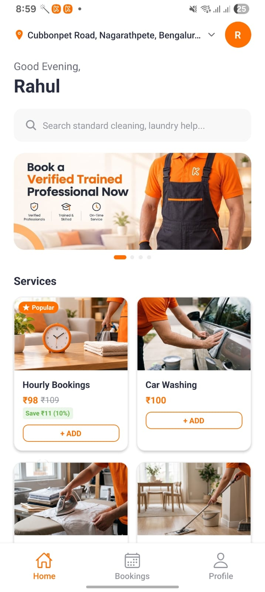 | 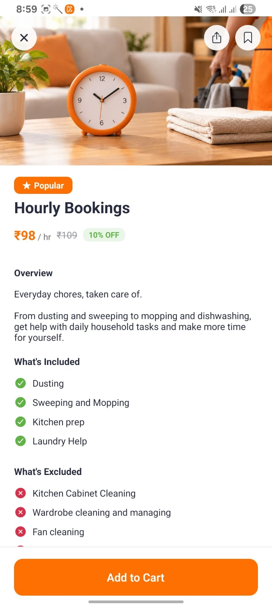 | 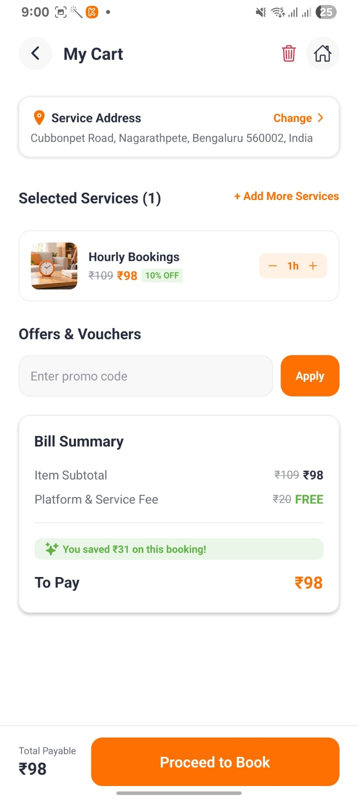 |
| Browse services, saved address, search | Inclusions and exclusions, per-hour pricing | Duration stepper, promo code, itemised bill |

| 4. Schedule a slot | 5. Helper on the way | 6. Service in progress |
| :---: | :---: | :---: |
| 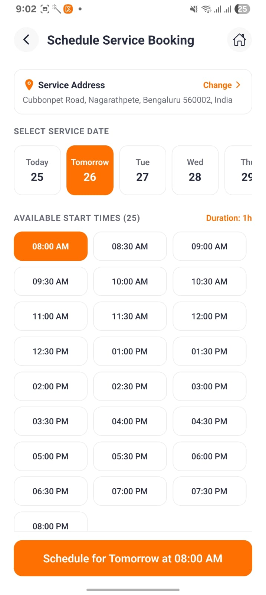 | 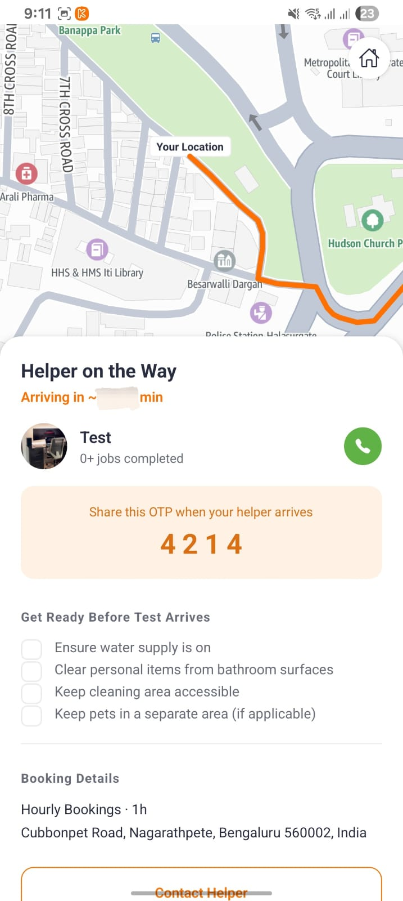 | 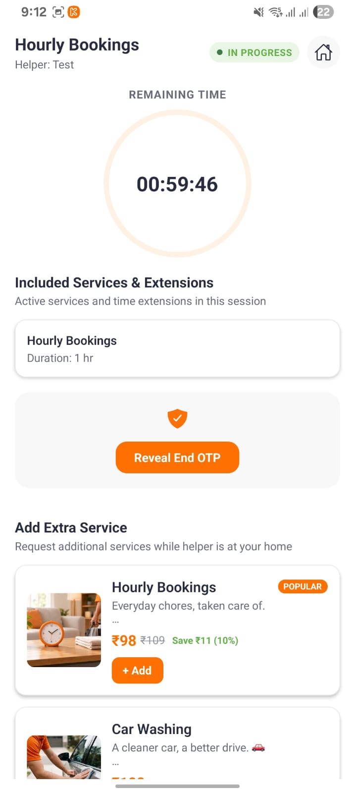 |
| Date and 30-minute start-time slots | Live route, Start OTP, pre-arrival checklist | Countdown timer, End OTP reveal, mid-job add-ons |

### Partner App

| 1. Home dashboard | 2. Availability planning | 3. Booking requests |
| :---: | :---: | :---: |
| 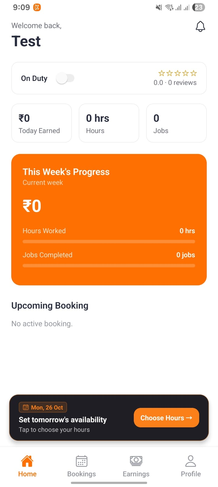 | 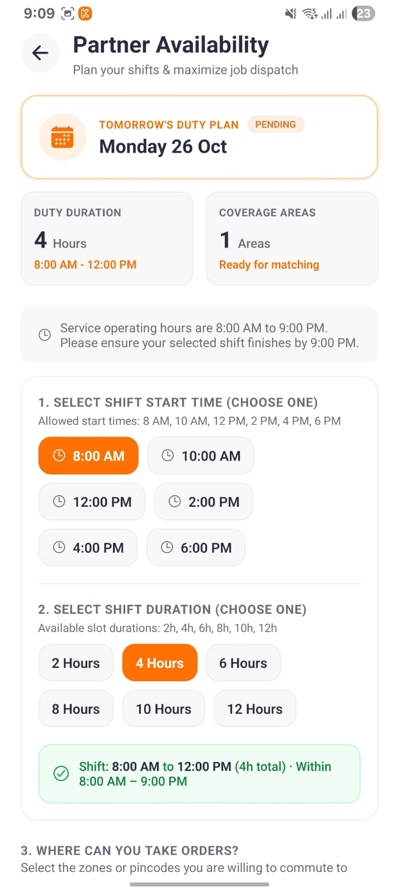 | 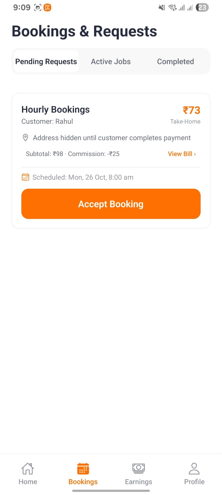 |
| Duty toggle, daily and weekly earnings | Shift start, duration, and coverage zones | Take-home preview and commission; address hidden until payment |

| 4. Active job | 5. Earnings | 6. Referrals |
| :---: | :---: | :---: |
| 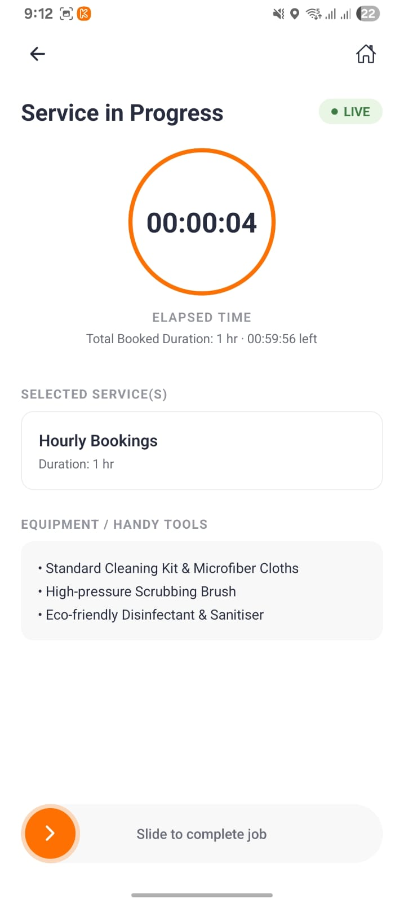 | 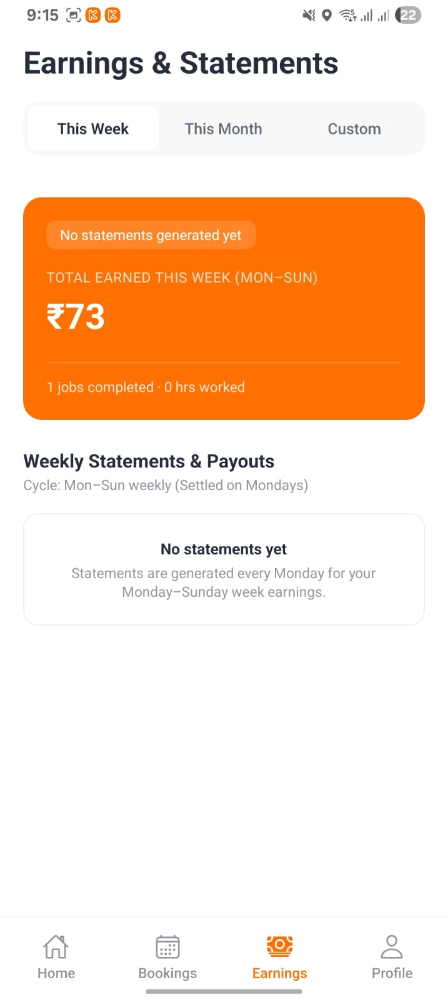 |  |
| Elapsed timer, tools list, slide to complete | Weekly (Mon-Sun) earnings and statements | Referral code and bonus tracking |

## Architecture

The Admin Portal is hosted on Cloudflare Workers. The mobile apps call the NestJS REST API directly over HTTPS. The API runs as a containerised service on **AWS Fargate** and handles compression, CORS, and request validation in-process. Secrets are loaded from AWS Secrets Manager, and AWS networking (VPC and VPC endpoints) is configured for private service connectivity. Deployment details are intentionally summarised.

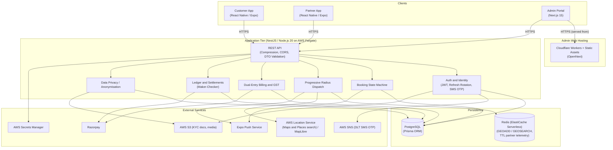

Partner location telemetry is sent via periodic HTTP requests, and push alerts are delivered through the Expo Push Service. The system does not use WebSockets.

## Booking Lifecycle

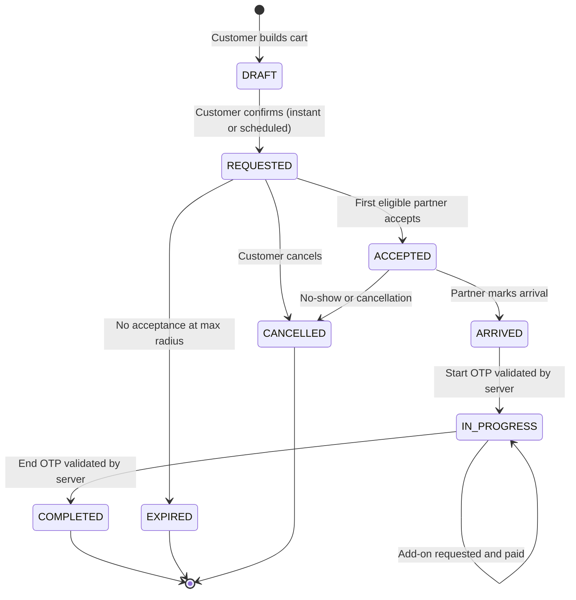

On `COMPLETED`, the system generates immutable customer and partner bills, records partner earnings in the ledger, and opens the rating flow.

## Key Engineering Decisions

### 1. Progressive radius dispatch on Redis geospatial indexes
- On-duty partners are stored in a Redis geospatial set (`GEOADD`), with telemetry hashes expiring on a TTL (120 seconds).
- When an instant booking is requested, the matcher searches with `GEOSEARCH` in stepped radii: **0.8 km, 1.5 km, 2.5 km, 4 km, 5 km**, re-evaluating every **10 seconds**.
- Partners already notified in an earlier step are tracked so only newly discovered candidates receive alerts.
- If the Redis index is unavailable or evicted, dispatch falls back to indexed relational queries over active partners in the service area.
- At maximum radius the request is held for 5 minutes, then moves to `EXPIRED` and the customer is notified.

### 2. Immutable dual-entry billing
- Each completed job produces two bills, a **Customer** bill and a **Partner** bill, enforced by a unique composite constraint on `[bookingId, billType]`.
- The customer bill captures services, platform fees, discounts, wallet credits, tips, and amount paid. The partner bill captures gross value, platform commission, pass-through tips, and net earnings.
- Mid-job add-ons are appended using idempotency keys (`bookingId_addonId`), so repeated webhooks or double taps cannot create duplicate charges.
- GST-formatted sequential invoices are generated for accounting.

### 3. Append-only partner ledger with atomic settlement
- Penalties, incentives, tips, and payouts are stored as append-only `PartnerLedgerEntry` rows.
- Unsettled entries (`settlementId = null`) are selected, totalled, and stamped with the payout ID inside a single database transaction, preventing double settlement from concurrent runs or repeated admin actions.

### 4. Anonymisation instead of hard deletion
- Account erasure scrubs direct identifiers (name, email, avatar, date of birth, gender) rather than cascading deletes, preserving financial and audit records.
- Phone numbers are replaced with deterministic pseudonyms to satisfy unique constraints without breaking foreign keys.
- Deletion is blocked while active bookings, unsettled payouts, or open disputes exist.
- This is designed with India's DPDP Act, 2023 in mind. It has not had a formal legal compliance review.

### 5. Scheduling buffers
- A 30-minute travel buffer is enforced between a partner's consecutive bookings. Example: a job from 10:00 to 13:00 allows the next booking at 13:30, while 13:29 is rejected as a conflict.

## Data Layer

- **PostgreSQL**, accessed via **Prisma ORM**.
- Local development uses a tuned PostgreSQL 16 container. Its settings in `infra/docker-compose.yml` are: `max_connections=200`, `shared_buffers=256MB`, `work_mem=8MB`, `maintenance_work_mem=128MB`, `effective_cache_size=768MB`, `random_page_cost=1.1`, `checkpoint_completion_target=0.9`.
- Composite indexes cover the main access paths: bookings by `(partnerId, status)` and `(customerId, status)`, ledger by `(partnerId, settlementId)`, bills by `(bookingId, billType)`, and partner duty status.
- **Redis** (AWS ElastiCache Serverless in the deployed environment) is used for geospatial matching and ephemeral partner telemetry.

## Tech Stack

| Layer | Technology |
| :--- | :--- |
| Mobile apps | React Native / Expo, Expo Router, MapLibre GL, Reanimated, Expo SecureStore |
| Admin web | Next.js 15, React 18, Tailwind CSS, TanStack Query |
| Backend | NestJS 10, Node.js 20 LTS, Passport JWT, class-validator |
| ORM / DB | Prisma 5.19, PostgreSQL |
| Cache / geo | Redis via ElastiCache Serverless (ioredis) |
| Storage | AWS S3 (SDK v3, presigned URLs) |
| SMS | AWS SNS with DLT template configuration |
| Maps | AWS Location Service (maps and places search), MapLibre |
| Deployment | AWS Fargate (API), ElastiCache Serverless (Redis), AWS Secrets Manager, VPC with VPC endpoints |
| Payments | Razorpay (orders, payment links, webhooks) |
| Push | Expo Server SDK (chunked delivery, ticket validation) |
| Admin hosting | Cloudflare Workers via `@opennextjs/cloudflare` and Wrangler |
| Tooling | Turborepo, pnpm workspaces |

## Security

- **Authentication:** 15-minute access tokens plus hashed, rotated refresh tokens, stored in Expo SecureStore on mobile. The client uses a single-flight refresh so concurrent 401 responses trigger one refresh request.
- **Physical verification:** Start and End OTPs are generated and validated server-side.
- **Webhook safety:** Razorpay webhooks are verified by HMAC-SHA256 signature and de-duplicated by payment ID.
- **Maker-checker:** Sensitive admin actions (manual wallet adjustments, partner suspension, custom payouts) require a second administrator to approve.
- **Secrets management:** credentials and keys are held in AWS Secrets Manager, not in source code.
- **Network:** the AWS VPC and VPC endpoints are configured so services connect over AWS networking.
- **KYC documents:** Stored in S3 and accessed through presigned URLs.

## Testing

Automated scripts in `apps/api` cover the highest-risk logic:

| Area | Script | What it checks |
| :--- | :--- | :--- |
| Scheduling | `test-flow-verification.ts` | 30-minute buffer boundary (13:30 allowed, 13:29 blocked) |
| Billing | `test-billing.ts` | Platform fee slabs, customer and partner totals, elapsed-timer math |
| Idempotency | `test-billing.ts` | Re-appending the same add-on does not duplicate line items |

A production-scale load test of the Redis geospatial path has not been run yet.

## My Learnings

I built Knotify end to end on my own. It was my first major project, and most of the technology in it was new to me when I started.

**Cloud and deployment (AWS)**
- Learned how to deploy and run my backend as a containerised service on **AWS Fargate**, and how to deploy and operate services on **EC2**.
- Learned to set up AWS networking: a **VPC** and **VPC endpoints** so services connect privately.
- Used **ElastiCache Serverless** for Redis alongside PostgreSQL.
- Learned to keep credentials out of code and config files by managing them with **AWS Secrets Manager**.
- Learned **AWS Location Service** (maps and places search) with **MapLibre** for geocoding, address search, routes, and map rendering in the mobile apps.

**Data and performance**
- Learned how **Redis geospatial indexes** work (`GEOADD` / `GEOSEARCH`) and why they suit "find the nearest partners" better than spatial queries on relational tables.
- Coming from MySQL, I learned **PostgreSQL**, including **indexing**: composite indexes, how to choose columns for the queries that run most often, and why unique constraints matter for correctness.
- Learned to think about the **hottest path** of a product, meaning the operations that run most often or are most latency-sensitive (here, partner location updates and dispatch matching), and to design those first.

**Mobile and frontend**
- Learned **React Native** with Expo by building two production-style apps, plus a Next.js admin portal.

**Systems thinking**
- Learned how scalable systems are shaped: keeping the server as the single source of truth, making money-related operations idempotent, and separating fast in-memory work from durable storage.
- Learned to manage **several connected systems at once**. The customer app, partner app, admin portal, and backend all depend on the same booking states and rules, so a change in one often affects the others. That taught me to design API contracts and state transitions carefully, and to test the full flow, not just single screens.

## Known Limitations and Roadmap

Being explicit about the current state:

- **No CI/CD pipeline yet.** Build, test, and deployment steps are not automated.
- **No API rate limiting** is configured yet (no throttler or edge rate limits).
- **No API gateway or reverse-proxy configuration** exists in the repository. The NestJS service handles compression and CORS itself.
- **No custom CDN or cache policy.** Admin assets use Cloudflare's platform defaults. Media is served directly from S3 or local storage.
- **Refresh tokens rotate but do not track token families**, so replay detection with cascading revocation is not implemented.
- **Dispatch timeouts run in-process**, which limits horizontal scaling of workers.
- **Bank payouts are manual** (UTR reference upload by an admin).

Planned work:

- [ ] Add a CI/CD pipeline (automated build, test, and deploy to Fargate)
- [ ] Add rate limiting (NestJS Throttler, plus edge rules)
- [ ] Refresh-token family tracking with replay detection
- [ ] Move dispatch timeouts to BullMQ / Redis Streams for multi-worker scaling
- [ ] Automated payouts via RazorpayX / IMPS
- [ ] Surge pricing based on demand and supply
- [ ] Spatial sharding of Redis geosets for multi-city expansion
- [ ] Load-test harness and published throughput benchmarks

## Source Code Notice

Knotify is a proprietary commercial project. This repository contains architecture documentation, diagrams, and approved visuals only. Application source, migrations, schemas, secrets, and production configuration are private. Reproduction or redistribution without written consent is prohibited.

## Contact

- **Email:** nishantmalhotra8009@gmail.com
- **LinkedIn:** https://linkedin.com/in/nishantmalhotra8009
- **GitHub:** https://github.com/nishant-malhotra-dev